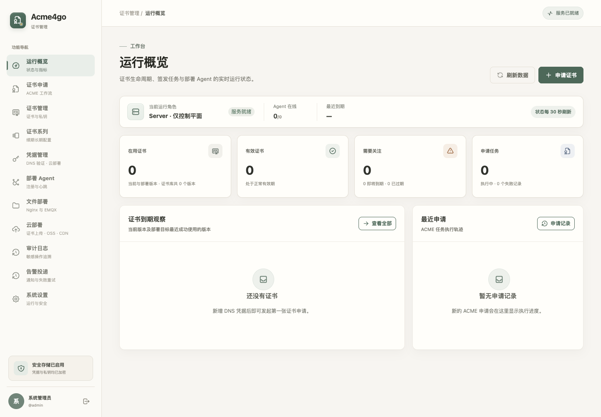
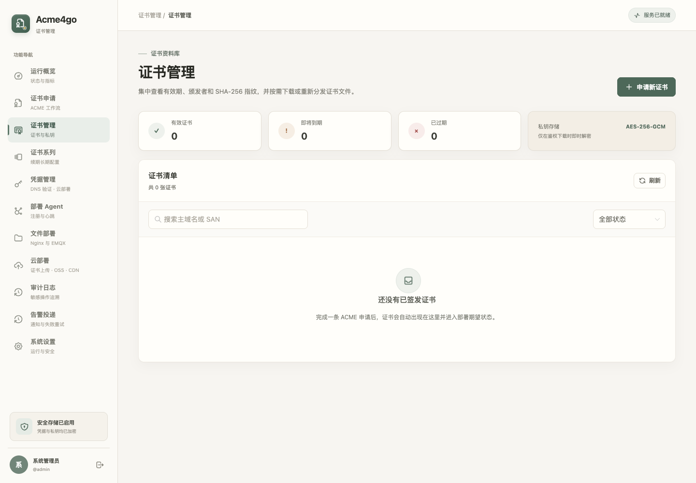

# Acme4go

Acme4go 是面向小型团队和自托管场景的 ACME 证书控制平面。它用一个 Go 二进制和一个容器镜像完成证书申请、自动续期、加密保管及跨主机文件部署；不依赖 Java、Redis、消息队列或外部数据库。

项目采用 Go、SQLite 和 Vue 3，适合从单机开始部署，也支持通过 Agent 向远程主机分发证书。项目当前按全新架构实现，不包含 Acme4j 的数据迁移与兼容层。

[快速开始](#快速开始) · [远程 Agent](#部署远程-agent) · [配置](#配置) · [本地开发](#本地开发) · [安全与备份](#安全边界) · [文档导航](#文档导航)

## 系统运行截图

以下截图来自使用空数据初始化的演示环境。

管理端概览：



证书管理：



## 功能概览

- 一个仓库、一个二进制、一个镜像。
- 两种运行角色：`server`、`agent`。
- `server` 始终提供控制平面、管理端、ACME 签发与 Agent API；默认启用本机执行器，适合绝大多数单机用户。
- `ACME_LOCAL_DEPLOYMENT_ENABLED=false` 可关闭 Server 的本机文件部署能力，形成只向远程 Agent 分发证书的独立控制平面。
- `agent` 只主动连接控制面，不监听任何端口，不需要控制面 SSH 到业务服务器。
- 控制面采用 Go 模块化单体、SQLite WAL、Vue 3 管理端；Agent 与控制面之间使用内部 CA 签发的 mTLS 身份。
- ACME 流程基于 lego，支持阿里云 DNS 与 Cloudflare API Token 的 DNS-01 验证，可签发普通域名和通配符证书。
- 云部署支持阿里云证书上传、已有云证书选择，以及 OSS/CDN 证书绑定更新；上传和部署可独立配置，也可跟随本地续期自动执行。见[云部署接入与扩展说明](docs/cloud-deployment.md)。

```text
浏览器 ── Cookie + CSRF ──> 管理面 :8080
                              │
                              ├─ SQLite / AES-256-GCM 加密证书库
                              ├─ ACME + 阿里云 / Cloudflare DNS-01
                              └─ Agent 面 :9443（HTTPS / mTLS）
                                         ▲
                                         │ 主动拉取期望状态
                      无入站端口的 Agent ─┘
                              │
                              └─ <deployment-dir>/<alias>/current/*.pem
```

## 快速开始

需要 Docker 24+、Docker Compose v2 和 OpenSSL。下面的命令从源码构建本地镜像，不依赖预先发布的镜像。

1. 克隆仓库并构建镜像：

```bash
git clone https://github.com/twodogleee/acme4go.git
cd acme4go
docker build -t acme4go:local .
```

2. 复制配置模板，生成主密钥：

```bash
if [ ! -e docs/compose.local.yaml ] && [ ! -L docs/compose.local.yaml ]; then
  (umask 077; cp docs/compose.yaml docs/compose.local.yaml)
fi
cd docs
openssl rand -base64 48
# 在 compose.local.yaml 中填写主密钥、初始密码，并将 image 改为 acme4go:local
chmod 600 compose.local.yaml
mkdir -p data deployments
sudo chown -R 65532:65532 data deployments
chmod 700 data
chmod 750 deployments
```

将生成的随机字符串填入 `ACME_MASTER_KEY`，并填写至少 12 位的 `ACME_ADMIN_PASSWORD`。从其他主机访问时，还需将 `ACME_PUBLIC_URL` 和 `ACME_AGENT_PUBLIC_URL` 改为实际可访问的地址。`compose.local.yaml` 已被 Git 忽略，避免将本机配置误提交。

3. 启动并访问管理端：

```bash
docker compose -f compose.local.yaml up -d
docker compose -f compose.local.yaml ps
```

默认本机访问地址和账号为：

- 管理端：<http://127.0.0.1:8080>
- Agent HTTPS：<https://127.0.0.1:9443>
- 用户名：`admin`；需要修改时在 Compose 的 `environment` 下增加 `ACME_ADMIN_USERNAME`

主密钥用于解密共享凭据、ACME 账户密钥、证书私钥和内部 CA 私钥。数据目录已经生成后，不能随意修改或丢失该密钥。已有实例切换配置方式时，必须将原主密钥原样填入 Compose。填写真实凭据后的 Compose 文件应受限保存，不提交到代码仓库。

如需构建并推送到自己的镜像仓库，可配置根目录的 [`package.sh`](package.sh)，并同步修改 Compose 的 `image`。模板中的镜像地址仅作为现有配置示例，不保证可公开拉取；完整说明见[镜像构建与发布](docs/deployment.md#32-使用脚本打包并推送)。

### 首次业务流程

1. 登录管理端，在“凭据管理”中添加阿里云 AccessKey 或 Cloudflare API Token，勾选“DNS 验证”并填写根域名，再验证 DNS 权限。同一份阿里云凭据还可以勾选“云部署”用途。
2. 在“证书申请”中先选择 Let's Encrypt 测试环境完成一次申请。
3. 验证成功后使用生产环境申请正式证书。
4. 在“文件部署”中创建目标，选择本机或一个 Agent、稳定证书系列和目录别名。
5. 业务容器只读挂载宿主机的 `docs/deployments` 目录，固定读取 `<alias>/current/fullchain.pem` 与 `<alias>/current/private-key.pem`。

本机和远程 Agent 目标均可“立即同步”；远程请求由 Agent 下次拉取执行。自动检查在文件和版本正常时跳过重复部署，详见[文件部署同步说明](docs/file-deployment-sync.md)。

## 部署远程 Agent

`server` 可以同时管理本机执行器与任意数量的远程 Agent。

1. 在管理端“部署 Agent”页面创建一次性注册信息。
2. 复制生成的 `acme4go://join/...` URL。它包含控制面地址、一次性令牌和内部 CA 证书，10 分钟后或使用一次后失效。
3. 在目标服务器准备源码或 Compose 模板，以及本机已构建或可拉取的镜像；复制模板后启动：

```bash
if [ ! -e docs/compose.agent.local.yaml ] && [ ! -L docs/compose.agent.local.yaml ]; then
  (umask 077; cp docs/compose.agent.yaml docs/compose.agent.local.yaml)
fi
cd docs
# 在 compose.agent.local.yaml 中填写 ACME_AGENT_JOIN_URL，并修改 image
chmod 600 compose.agent.local.yaml
mkdir -p agent-data agent-deployments
sudo chown -R 65532:65532 agent-data agent-deployments
chmod 700 agent-data
chmod 750 agent-deployments
docker compose -f compose.agent.local.yaml up -d
```

注册成功后，Agent 将身份和私钥以 `0600` 权限保存在 Compose 同级的 `./agent-data` 目录中，证书运行文件写入同级 `./agent-deployments`；注册成功后清空 `compose.agent.local.yaml` 中的 Join URL，后续启动不再需要它。Agent 每 30 秒主动心跳并拉取期望状态，客户端证书在到期前 30 天自动续签。撤销 Agent 后，控制面立即拒绝其证书下载请求。

Agent 不开放端口、不使用 SSH、不访问 Docker Socket，也不执行 Nginx/EMQX reload 命令。应用负责监视文件或按自身方式重新加载。

## 运行角色与部署拓扑

| 角色 | 启动命令 | 管理端 | Agent API | 职责 |
|---|---|---:|---:|---|
| `server` | `acme4go server` | 是 | 是 | 控制平面、ACME 签发、期望状态与可选本机执行器 |
| `agent` | `acme4go agent` | 否 | 仅作为客户端 | 在 Nginx、EMQX、MQTT 或边缘节点部署证书 |

`ACME_ROLE` 可设置未传命令行参数时的默认角色，命令行角色优先。Server 是否承担本机部署不是第三种角色，而是一个独立能力：

| 拓扑 | 启动方式 | 说明 |
|---|---|---|
| 单节点（默认推荐） | `acme4go server` + `ACME_LOCAL_DEPLOYMENT_ENABLED=true` | 主节点同时管理、签发并向本机业务部署证书 |
| 混合部署 | 单节点配置 + 若干 `acme4go agent` | 主节点与远程业务节点都可作为证书执行器 |
| 纯控制平面 | `acme4go server` + `ACME_LOCAL_DEPLOYMENT_ENABLED=false` | 主节点只管理和签发，所有证书由远程 Agent 落地 |

## 文件契约

每个部署目标使用一个受严格校验的目录别名：

```text
deployments/
└── nginx-public/
    ├── active.version
    ├── current -> versions/<SHA256 指纹>
    └── versions/<SHA256 指纹>/
        ├── certificate.pem
        ├── fullchain.pem
        ├── private-key.pem
        └── metadata.json
```

新版本先写入不可变版本目录并执行 `fsync`，验证完成后原子切换 `current` 符号链接。任何失败都不会覆盖当前可用版本。证书与链权限为 `0644`，私钥和元数据为 `0640`；容器默认 GID 为 `65532`，业务容器可使用同组只读访问。

控制面的内部证书库与 Agent 缓存中的私钥始终以 AES-256-GCM 密文保存。只有部署目录是业务进程需要读取的明文运行副本。

## 配置

Compose 部署直接修改本地配置副本中 `environment` 的字面值和 `image`、`ports`，无需另建环境文件。Server 模板只保留四项常用配置，Agent 模板只保留 Join URL，其余项使用程序内置默认值。高级配置按需添加到 `environment`，例如：

```yaml
environment:
  ACME_MASTER_KEY: "填写原主密钥或首次生成的主密钥"
  ACME_ADMIN_PASSWORD: "填写首次管理员密码"
  ACME_PUBLIC_URL: "https://acme-admin.example.com"
  ACME_AGENT_PUBLIC_URL: "https://acme-agent.example.com:9443"
  ACME_LOCAL_DEPLOYMENT_ENABLED: "false"
```

`environment` 用于将这些固定值传给容器内程序，不引用宿主机环境变量。已有 `docs/.env` 或 `agent.env` 不再控制这两个 Compose 文件；升级时将需要保留的原配置直接迁入 YAML。

直接运行二进制或本地开发时，程序仍支持当前工作目录的 `.env`，也可通过 `ACME_ENV_FILE` 指定文件。该模式的配置优先级为“命令行角色 > 已存在的进程环境变量 > `.env` > 内置默认值”；敏感项对应的 `_FILE` 文件优先于同名普通变量。该支持不影响 Compose 直接配置方式，也与打包专用 `.package.env` 无关。

### 应用配置完整清单

| 变量 | 角色 | 默认值或要求 | 作用 |
|---|---|---|---|
| `ACME_ENV_FILE` | 两者 | `./.env` | 显式指定环境文件；未指定且默认文件不存在时忽略 |
| `ACME_ROLE` | 两者 | `server` | 未传命令行角色时使用，只支持 `server` 或 `agent` |
| `ACME_VERSION` | 两者 | 构建版本 | 发布脚本注入的版本标识，通常无需手工设置 |
| `ACME_LOG_LEVEL` | 两者 | `info` | JSON 控制台日志最低级别，只支持 `debug`、`info`、`warn`、`error` |
| `ACME_LOCAL_DEPLOYMENT_ENABLED` | Server | `true` | 是否启用 Server 本机证书执行器 |
| `ACME_LISTEN_ADDRESS` | Server | `:8080` | 管理面 HTTP 监听地址 |
| `ACME_AGENT_LISTEN_ADDRESS` | Server | `:9443` | Agent HTTPS/mTLS 监听地址 |
| `ACME_PUBLIC_URL` | Server | `http://127.0.0.1:8080` | 浏览器实际访问来源，用于安全 Cookie 与同源校验 |
| `ACME_AGENT_PUBLIC_URL` | Server | `https://127.0.0.1:9443` | Agent 实际访问地址，必须是 HTTPS 且主机名可达 |
| `ACME_TRUSTED_PROXY_CIDRS` | Server | 空 | 可信反向代理来源 CIDR，多个值用逗号分隔 |
| `ACME_DATA_DIR` | 两者 | `./data` | Server 数据库和密钥或 Agent 身份的持久化目录；Compose 固定为 `/app/data` |
| `ACME_DEPLOYMENT_DIR` | 两者 | `./deployments` | 标准 PEM 物化根目录；Compose 固定为 `/app/deployments` |
| `ACME_MASTER_KEY` | Server | 持续必填 | 至少 32 字节的静态加密主密钥，数据创建后不得更换或丢失 |
| `ACME_MASTER_KEY_FILE` | Server | 空 | 主密钥 Secret 文件路径；设置后优先于 `ACME_MASTER_KEY` |
| `ACME_ADMIN_USERNAME` | Server | `admin` | 首次创建管理员时使用的登录名 |
| `ACME_ADMIN_PASSWORD` | Server | 首次启动必填 | 至少 12 位；管理员创建完成后程序不再使用该值 |
| `ACME_ADMIN_PASSWORD_FILE` | Server | 空 | 初始密码 Secret 文件路径；设置后优先于 `ACME_ADMIN_PASSWORD` |
| `ACME_SESSION_TTL` | Server | `24h` | 管理会话有效期 |
| `ACME_RENEW_BEFORE` | Server | `720h` | 证书到期前进入自动续期的窗口 |
| `ACME_SCHEDULER_INTERVAL` | Server | `1h` | 会话清理、续期扫描和部署对账周期 |
| `ACME_DNS_PROPAGATION_TIMEOUT` | Server | `3m` | DNS-01 记录传播最大等待时间 |
| `ACME_DNS_POLLING_INTERVAL` | Server | `5s` | DNS-01 传播查询间隔 |
| `ACME_ALERT_WEBHOOK_URL` | Server | 空 | 签发、部署失败、证书到期及 Agent 离线通知接收地址；生产必须为 HTTPS |
| `ACME_ALERT_WEBHOOK_SECRET` | Server | 启用通知时必填 | 至少 32 字节，用于 `X-Acme4go-Signature` HMAC-SHA256 签名 |
| `ACME_ALERT_WEBHOOK_SECRET_FILE` | Server | 空 | Webhook 签名密钥 Secret 文件路径，优先于普通变量 |
| `ACME_AGENT_JOIN_URL` | Agent | 首次注册必填 | 一次性注册 URL；身份落盘后应删除 |
| `ACME_AGENT_NAME` | Agent | 当前主机名 | 管理端显示的部署节点名称 |
| `ACME_AGENT_POLL_INTERVAL` | Agent | `30s` | 心跳和期望状态对账周期 |
| `ACME_HISTORY_RETENTION` | 两者 | `17520h`（730 天） | 终态订单、审计、部署记录和非当前部署版本保留期；每个目标至少保留最近 3 个历史版本 |

### 直接修改 Compose

| 配置位置 | 修改方式 |
|---|---|
| 顶层 `name` | 直接填写 Compose 项目名称，默认为 `acme4go` 或 `acme4go-agent` |
| 服务的 `image` | 在本地副本中填写可用的镜像地址和版本；快速开始使用本地构建的 `acme4go:local` |
| Server 的 `ports` | 修改冒号左侧的宿主机端口，默认 `8080:8080` 和 `9443:9443`；同步调整对应公开 URL |
| 服务的 `environment` | 直接填写配置值；需要高级参数时按上表添加相应键值 |

Compose 使用程序默认的容器内端口和运行目录，并挂载对应持久化目录。首次部署在本地副本填好主密钥、管理员密码和两个公开 URL；Agent 只需填写一次性 Join URL。使用 `_FILE` 时还必须由 Docker Secret、Kubernetes Secret 或额外挂载把对应文件放入容器。

### 备份与诊断

Server 可以在不复制 WAL 中间状态的情况下创建一致备份，并检查数据库、加密证书材料和本机部署目录：

```bash
./acme4go backup /secure/backup/acme4go-$(date +%F).tar.gz
./acme4go doctor
```

备份归档以 `0600` 创建，包含 SQLite 一致快照、内部 CA 和加密证书材料，不包含通过环境变量或外部 Secret 文件注入的 `ACME_MASTER_KEY`。恢复必须同时提供原主密钥；建议在独立目录解包后先运行 `doctor`，再切换生产实例。备份命令拒绝覆盖已有文件。

默认 `info` 级别会在进程启动时输出一次最终生效配置摘要，便于确认角色、监听地址、公开地址、运行目录和调度周期。摘要不会记录主密钥、管理员密码、Join URL、Secret 文件路径或 URL 用户信息；公开 URL 只保留协议和主机。设置 `ACME_LOG_LEVEL=warn` 或 `error` 时，按所选级别规则不输出这条 `INFO` 摘要。

## 本地开发

需要 Go 1.27+、Node.js 24+ 和 npm 11+。Go 程序会嵌入前端静态资源；全新克隆后，运行 `go run`、`go test` 等 Go 命令前须先安装前端依赖并构建资源。

```bash
cp docs/.env.example .env
cd frontend && npm ci && npm run build && cd ..
# 在 .env 中填写 ACME_MASTER_KEY 和 ACME_ADMIN_PASSWORD
go run ./cmd/acme4go server
```

管理端热更新时，先在 `.env` 中设置以下值：

```dotenv
# 浏览器实际来源必须与 ACME_PUBLIC_URL 一致；端口被占用时同步修改监听地址
ACME_LISTEN_ADDRESS=:18080
ACME_PUBLIC_URL=http://localhost:5173
```

然后分别启动后端和前端开发服务器：

```bash
# 终端一
go run ./cmd/acme4go server

# 终端二
cd frontend
npm run dev
```

浏览器访问 <http://localhost:5173/login>，不要直接打开 `/api/auth/login`；后者是只接受 JSON `POST` 的接口。Vite 会读取项目根目录 `.env` 中的 `ACME_LISTEN_ADDRESS` 并自动代理 `/api`，无需重复配置后端端口。完整验证与发布构建可一次执行，前端只构建一次：

```bash
make all VERSION=0.1.0
./bin/acme4go --version
```

`make verify` 也会先安装前端依赖并构建静态资源，再运行各项检查，因此可在全新克隆后直接使用。

前端开发工具的 `minimatch` 11.x 覆盖用于处理 [GHSA-g3hv-75wg-m249](https://github.com/advisories/GHSA-g3hv-75wg-m249)；目前部分上游依赖仍声明使用 10.x。项目测试会检查 ESLint 对源码、配置文件和忽略目录的实际匹配。上游发布声明支持安全版本的稳定版后，应逐项移除对应覆盖，并重新运行 `npm audit` 和前端检查。

## 安全边界

- 管理员密码使用 Argon2id 加盐摘要，不可逆保存。
- 会话使用 HttpOnly、SameSite Cookie；数据库只保存会话和 CSRF 令牌的 SHA-256 摘要。
- 所有写请求校验 CSRF；私钥下载即使是 GET 也额外要求 CSRF Token，响应禁止缓存。
- DNS Secret、ACME 账户私钥、证书私钥和内部 CA 私钥均使用用途绑定的 AES-256-GCM 信封加密。
- Agent 使用独立内部 CA 和 TLS 1.3；一次性注册令牌只保存摘要。
- Agent 只能下载明确分配给自己的证书，证书材料在落盘前验证 SHA-256 指纹、SAN、有效期和密钥对。
- 撤销 Agent 会立即切断 API 权限，但不会破坏业务服务器上正在使用的证书文件。
- SQLite 开启 WAL、外键、`synchronous=FULL` 与忙等待，数据库连接限制为单写连接。
- 新数据库以 `internal/store/schema.sql` 为唯一权威结构，已有数据库在 Server 启动时由带版本记录的 Go 幂等迁移自动升级；成功版本写入 `schema_migrations`，后续启动不会重复执行昂贵迁移，也不要手工执行 `migrations/*.sql`。

更完整的边界与威胁模型见 [docs/security.md](docs/security.md)，架构细节见 [docs/architecture.md](docs/architecture.md)，HTTP API 见 [api/openapi.yaml](api/openapi.yaml)。

## 备份与恢复

必须成组备份：

- `ACME_DATA_DIR` 全部内容；
- 与该数据目录匹配的 `ACME_MASTER_KEY`；
- 如需立即恢复业务运行副本，再备份 `ACME_DEPLOYMENT_DIR`，否则恢复后可由控制面对账重新生成。

不要只复制正在写入的 `acme4go.db`。推荐停止容器后复制整个 `./data` 目录，或使用 SQLite 在线备份工具。恢复时保持原主密钥和数据目录权限，再启动相同或更高版本镜像。

## 文档导航

- [部署与运维](docs/deployment.md)：服务端、Agent、镜像打包和运行配置。
- [系统架构](docs/architecture.md)与[安全说明](docs/security.md)：组件职责、信任边界与安全设计。
- [凭据管理](docs/credentials.md)与[云部署](docs/cloud-deployment.md)：DNS 验证、云证书及云资源绑定。
- [文件部署同步](docs/file-deployment-sync.md)与[运维查询和通知](docs/operations-and-notifications.md)：证书分发、查询与告警。
- [OpenAPI 接口定义](api/openapi.yaml)：管理 API 与 Agent API 契约。

## 当前范围

- 已实现阿里云 DNS 与 Cloudflare；其他 DNS Provider 可通过 `internal/dnsprovider` 与 lego Provider 适配层继续增加。
- 当前是单控制平面设计，SQLite 数据目录不能被多个控制面实例同时共享。
- Agent 是证书文件交付器，不负责业务进程重载、服务编排或远程命令执行。
- 项目采用全新 Schema，不提供 Acme4j 数据迁移。

订单与证书支持全量筛选，订单详情提供脱敏阶段时间线；告警采用 SQLite 持久队列，支持自动重试、投递历史与人工重发。完整行为、Cloudflare 权限和升级说明见 [运维查询与通知](docs/operations-and-notifications.md)。

## 开源协议

本项目采用 [Apache License 2.0](LICENSE)。
